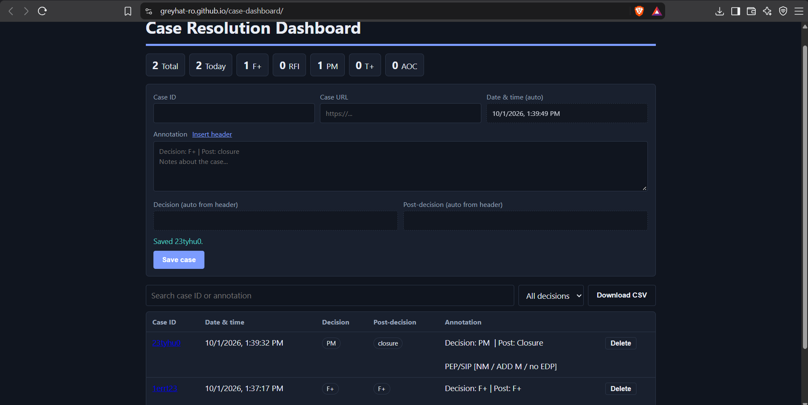

# Case Resolution Dashboard

A static web app for logging resolved cases. Runs entirely in the browser and is hosted on GitHub Pages.

**Live demo:** https://greyhat-ro.github.io/case-dashboard/

## Features
- Case ID, case URL and annotation inputs
- Date and time filled automatically when a case is saved
- Decision and Post-decision filled automatically from the annotation header
- Search, filter by decision, delete, CSV export, summary counts
- Input validation (duplicate IDs, invalid URLs, invalid header values)

## Annotation header
The first line of the annotation sets the two auto-filled fields:

    Decision: F+ | Post: closure
    Notes about the case...

- Decision: `F+`, `RFI`, `PM`, `T+`, `AOC`
- Post-decision: `F+`, `PM`, `closure`, `disablement`, `escalation`, `RFI`

## Run locally
Open `index.html` in a browser. No build step or dependencies.

## Limits
Data is saved in each browser's `localStorage`. Use fake data on a public site.

## Ideas
Shared database (Firebase/Supabase), logins, edit cases, weekly summary charts.

## Screenshot

